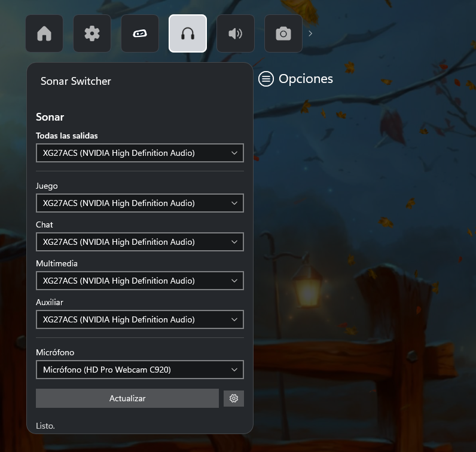

# Sonar Switcher

**Unofficial Xbox Game Bar widget to switch SteelSeries Sonar's output and microphone devices, designed for controller use.**

**English** | [Español](README.es.md)

> **Disclaimer:** this is a personal, community project. **It is not affiliated with, endorsed by, or sponsored by SteelSeries.**
> "SteelSeries" and "Sonar" are trademarks of their respective owners and are mentioned only to indicate compatibility.
> It uses GG/Sonar's local API, which is **unofficial and undocumented**: it may stop working with any GG update.
> This repository does not include or distribute any SteelSeries software, and no reverse engineering of GG/Sonar was done:
> the widget only sends requests to the local server that GG exposes on your own PC.
> If SteelSeries asks for it, the project will be taken down.
> Provided as is, without warranty (see `LICENSE`).

## What it's for

If your PC is connected to a TV and you control everything with an Xbox controller, switching Sonar's audio output
(for example, from the TV to your headset) means going back to keyboard and mouse in the GG app. This widget lives inside
Game Bar (opened with the controller's Xbox button or `Win + G`) and lets you:

- Pick **a single device for all outputs** (Game, Chat, Media and Aux).
- Pick the device for **each channel** separately.
- Pick the **microphone**.

It shows the current values when opened and, after every change, checks that Sonar actually applied it.

## Using it

Open Game Bar (Xbox button on the controller or `Win + G`), open the widget menu and pick **Sonar Switcher**. Pin it if you want it to stay on screen.

- **Todas las salidas** (all outputs): choose one device and Game, Chat, Media and Aux are all sent to it at once. Handy to jump from the TV to your headset and back.
- **Juego, Chat, Multimedia, Auxiliar**: one selector per channel, to send each one to a different device.
- **Micrófono**: choose the input device Sonar uses.
- **Refresh button**: re-reads Sonar's current state (useful if you changed something in the GG app or plugged in a device).
- **Gear icon**: advanced options (GG's port).

The lists show only real devices that are currently active; Sonar's own virtual devices are hidden. After each change, the widget
reads the state back from Sonar and shows in the status line whether it was applied. Everything works with the controller
alone (D-pad to move, A to open and select).

## Requirements

- Windows 10 (1809 or later) or Windows 11, with **Xbox Game Bar** enabled.
- **SteelSeries GG with Sonar**, in **Classic mode** (Streamer mode is not supported).
- To build: **Visual Studio** with UWP tooling (in VS 2026: the *WinUI application development* workload with
  *Universal Windows Platform tools* and the Windows 11 SDK 10.0.26100).

Tested with an Arctis Nova 7X in Classic mode, in October 2026. Not tested with other devices or GG versions.

## Installation (installer)

1. Download `SonarSwitcher-Setup-1.0.0.exe` from the [Releases](../../releases) page (check its SHA256 against the one in the release notes).
2. Run it (it asks for administrator rights). It trusts the package's self-signed certificate, installs the widget and grants it
   access to `localhost`. Uninstalling "Sonar Switcher (instalador)" removes all of that.
3. Windows may show a SmartScreen warning because the installer is not code-signed. Game Bar may take a few seconds to
   come back after installing or uninstalling.
4. With GG and Sonar running, press `Win + G`, open the widget menu and look for **Sonar Switcher**.

## Installation (from source)

1. Clone the repository and open `SonarWidget.slnx` in Visual Studio.
2. Select the **x64** platform and build (`Ctrl + Shift + B`).
3. **Build > Deploy SonarWidget** (Windows may ask you to enable Developer Mode).
4. In PowerShell **as administrator**, run `exento-loopback.ps1`. UWP apps can't talk to `localhost`
   unless they are granted a network loopback exemption.
5. With GG and Sonar running, press `Win + G`, open the widget menu and look for **Sonar Switcher**.

The `Microsoft.Gaming.XboxGameBar` NuGet package is restored automatically when building.

## How it works

The widget talks to the local HTTP API used by the GG app itself:

1. `GET https://127.0.0.1:6327/subApps` (GG, self-signed certificate) returns Sonar's address. Sonar's port
   changes every time GG restarts, so the widget rediscovers it on its own (**Actualizar** / refresh button).
2. `GET /audioDevices` lists devices; Sonar's virtual devices are hidden.
3. `GET /classicRedirections` tells which device each channel uses.
4. `PUT /classicRedirections/{channel}/deviceId/{id}` changes a channel's device (`game`, `chat`, `media`, `aux`, `mic`).

GG's port (6327) can be edited in the advanced options (gear icon) in case yours differs; you can look it up in
`C:\ProgramData\SteelSeries\SteelSeries Engine 3\coreProps.json`, field `ggEncryptedAddress`.

## Known limitations

- Depends on an unofficial API; it can break without notice.
- Sonar Classic mode only; it doesn't change presets (Quickset) or volumes.
- The interface is in Spanish.
- It is not in the Microsoft Store: the installer uses a self-signed certificate, so Windows may show a SmartScreen warning.

## Transparency about AI use

This project was developed with AI assistance (Claude, by Anthropic): the code, documentation and icons were generated
with its help. The author defined the problem, directed the work and tested the result on their own machine.
The code has not been independently audited; review it before running it if that matters to you.

## License

MIT. See the `LICENSE` file.
